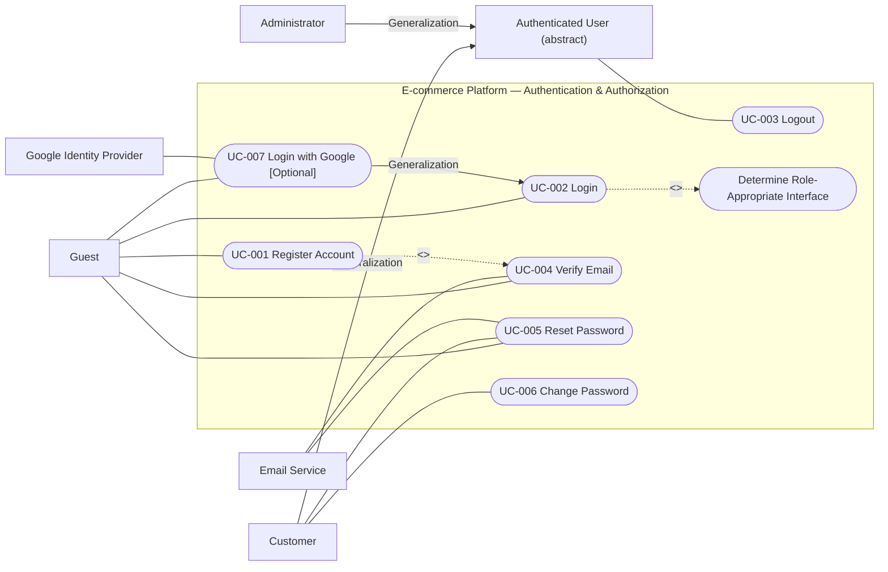
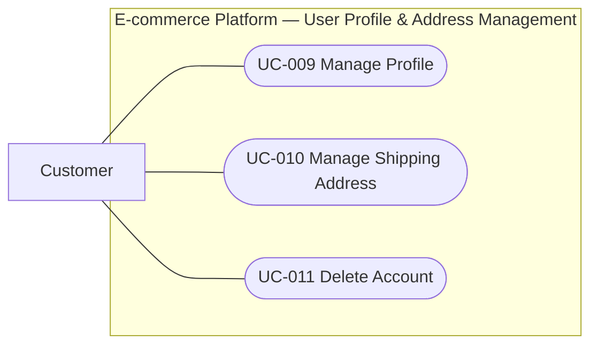
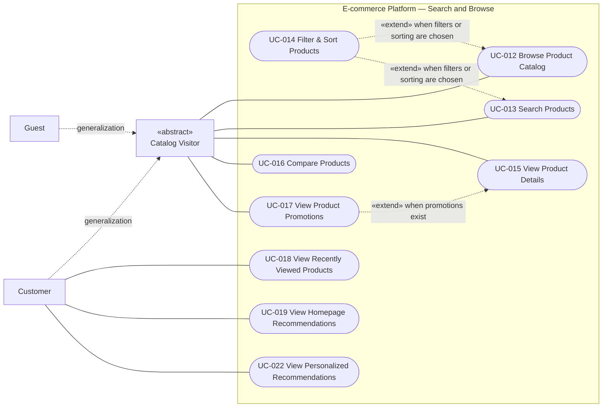
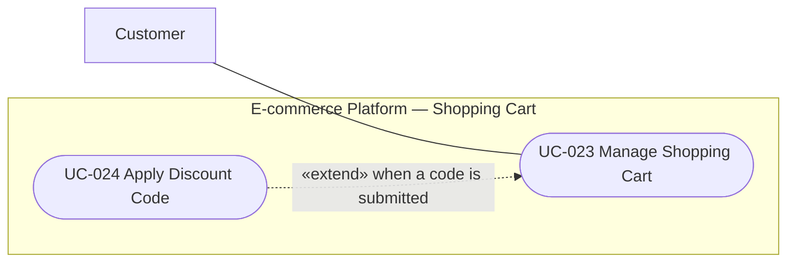
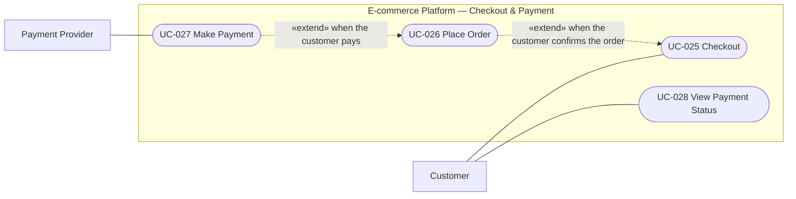
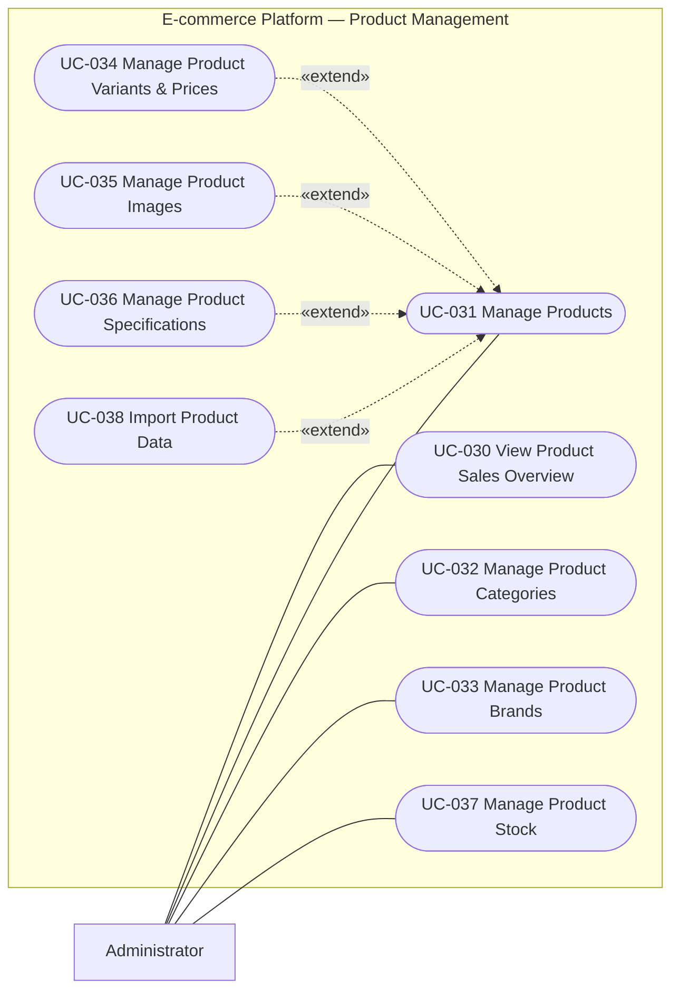
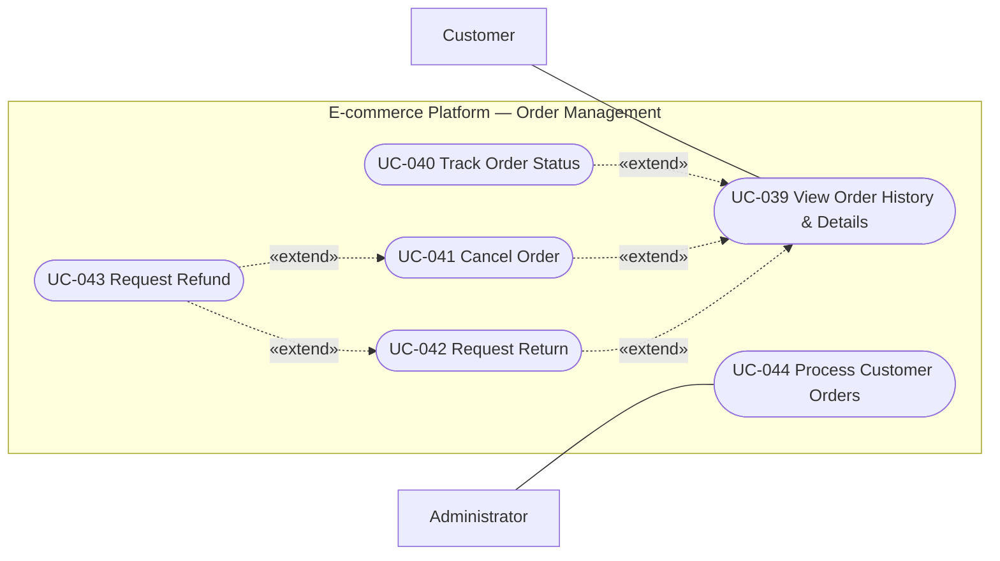
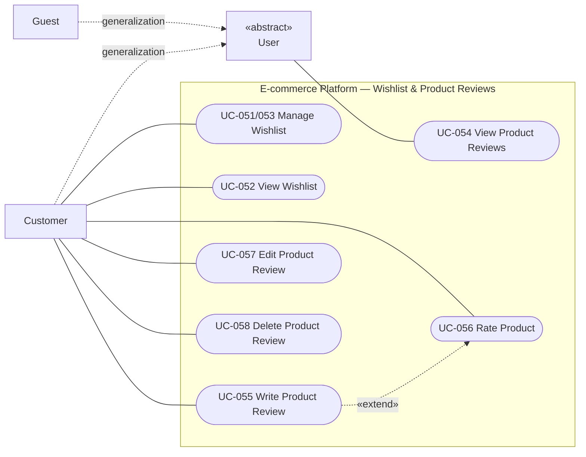
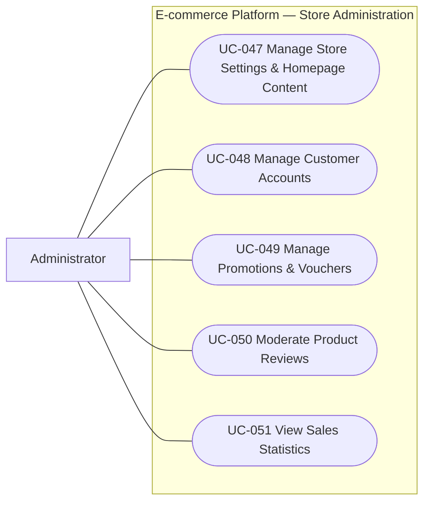
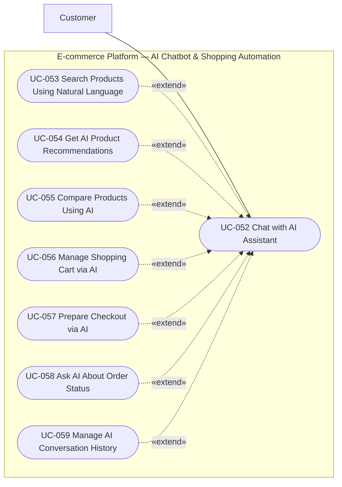

# Use Case Model

**Performed By**: Nguyễn Công Kiên, Phan Thị Thanh Huyền 
 
**Reviewed By**: Nguyễn Hoàng Gia

-
**System:** Electronics Store E-Commerce Platform  

## Actors and Notation

| Actor | Role |
| --- | --- |
| Guest | Registers, logs in, and browses the public catalog. |
| Customer | Manages their account, cart, payments, and orders. |
| Administrator | Uses shared authentication and confirms manually reconciled payments. |
| Email Service | Delivers verification, recovery, and restock emails. |
| Google Identity Provider | Authenticates users through Google. |
| Payment Provider | Processes online payments and confirms results. |

Mermaid diagrams represent use cases as rounded nodes inside the system boundary and actors outside it.

- Solid line: actor participation.
- `<<include>>`: mandatory reused behavior; arrow points to the included use case.
- `<<extend>>`: conditional behavior; arrow points to the base use case.
- `Generalization`: specialization; arrow points to the general actor or use case.
- `[Optional]`: optional feature. Other numbered use cases are core.
- `SUP-01` to `SUP-04`: supplemental use cases for restock notifications, checkout item selection, fulfillment selection, and recipient details. Nodes without IDs represent supporting behavior.

## FG-01: Authentication & Authorization

## FG-02: User Profile & Address Management

## FG-03: Search and Browse

## FG-04: Shopping Cart

## FG-05: Checkout & Payment

## FG-06: Product Management

## FG-07: Order Management

## FG-07: Wishlist & Product Reviews

## FG-09: Administration

## FG-10: AI Chatbot & Shopping Automation
